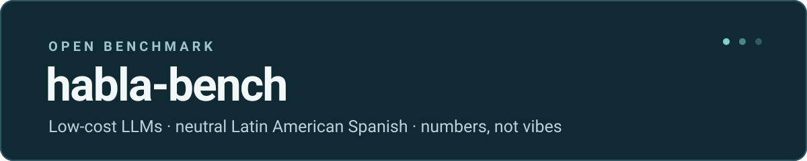
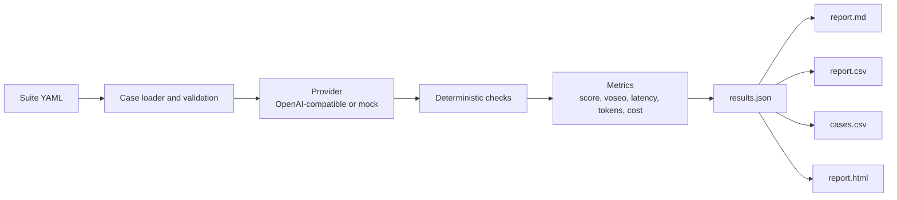

# habla-bench

[](LICENSE)
[](pyproject.toml)



**Pick the right low-cost LLM for Latin American Spanish, with numbers instead of vibes.**

Most teams choose a model for a Spanish-language chatbot after trying a handful of prompts and trusting a gut feeling. That works until a cheap model answers in voseo to a customer in Mexico City, writes like a call center in Madrid, or invents a price that was never in the catalog. Then the bill arrives, the support queue fills up, and nobody can explain why the model was chosen.

habla-bench is a small, open test bench for that decision. It sends a fixed suite of everyday requests to any API that speaks the OpenAI Chat Completions format, then scores the answers with deterministic checks: does it follow the format, does it stay in neutral Latin American Spanish, does it answer in Spanish when the user writes in English, and does it avoid prices that are not in the context? It also records latency, token usage, and an estimated cost per answer.

You do not need a data team to use it. Install it, point it at two or three candidate models, and read a one-page report with a comparable score, a voseo rate, and a cost estimate. The mock example below shows the shape of that report; replace the mock model ids with real ones to get numbers for your own shortlist.

## What you get

- A 0–100 score per model, overall and by category.
- A voseo rate and a peninsular-Spanish rate, so style problems are visible even when the overall score looks fine.
- Mean latency, input and output tokens, and an estimated cost when the provider returns `usage`.
- `report.md`, `report.csv` (one row per model), `cases.csv` (one row per case), and a self-contained `report.html` that works offline and in light or dark mode.
- A deterministic mock provider for demos, tests, and CI. No network, no keys.

## Quick start

1. Install Python 3.11 or newer and clone the repository.
2. Create and activate a virtual environment:
   ```bash
   python -m venv .venv
   # Linux / macOS
   source .venv/bin/activate
   # Windows PowerShell
   .\.venv\Scripts\Activate.ps1
   ```
3. Install the CLI:
   ```bash
   pip install -e .
   ```
4. Set your endpoint and key in the environment (never in a file):
   ```bash
   # Linux / macOS
   export HABLA_BASE_URL="https://openrouter.ai/api/v1"
   export HABLA_API_KEY="your-key-here"
   # Windows PowerShell
   $env:HABLA_BASE_URL = "https://openrouter.ai/api/v1"
   $env:HABLA_API_KEY = "your-key-here"
   ```
5. Run the suite and build the report:
   ```bash
   habla-bench run --models vendor/model-a,vendor/model-b --suite core --out results/
   habla-bench report results/
   ```

No key yet? Run the same pipeline offline with the mock provider:

```bash
habla-bench run --dry-run --models mock-a,mock-b --suite core --out results/
habla-bench report results/
```

The CLI reads only `HABLA_BASE_URL` and `HABLA_API_KEY` from the environment. It never writes a key to disk and it does not load `.env` files implicitly.

## Sample output

> **Sample output from the mock provider, not real benchmark results.** The model ids are fictional, latency and token usage are simulated, and prices are example values from `prices.yaml`.

| Model | Overall | instruction_following | neutral_spanish | language_lock | customer_service | Voseo rate | Spain rate | Avg latency | Est. cost |
| --- | ---: | ---: | ---: | ---: | ---: | ---: | ---: | ---: | ---: |
| `mock-a` | **93.4** | 96.3 | 90.7 | 91.7 | 95.4 | 0.0% | 5.6% | 1,095 ms | $0.002127 |
| `mock-b` | **75.2** | 75.9 | 76.5 | 66.7 | 80.5 | 5.6% | 8.3% | 662 ms | $0.001296 |

A full offline example lives in [`examples/sample-report.html`](examples/sample-report.html). Open it in any browser; it has no external assets.

The story in that sample is typical of real shortlists: the cheaper, faster model is also the one that slips into voseo and invents a number. That is exactly the trade-off the report is meant to expose.

## How it works



Every case has a `system` prompt, a `user` prompt, optional `context`, a category, a weight, and a list of checks. The runner sends one request per case and model, measures latency with a monotonic clock, and stores the raw response in `results.json`. There is no second model acting as a judge: a check is a pure function of the response and the context, which makes runs reproducible and cheap.

A case score is the share of its checks that pass, from 0 to 100. Category scores are weighted means of their case scores, and the overall score is the weighted mean of every case. Dropping a case into a suite therefore changes the benchmark in a visible, auditable way.

## Write your own suite

Create a YAML file and pass it with `--suite`:

```yaml
name: my-suite
description: Short requests for a fictional pharmacy chatbot.
cases:
  - id: pharmacy-hours-01
    category: customer_service
    context: >
      Farmacia Los Robles (ficticia). Atención: lunes a sábado, de 9:00 a
      20:00. Domingo cerrado.
    system: >
      Responde en español neutro, en menos de 30 palabras, usando solo datos
      del contexto.
    user: ¿Atienden los domingos?
    checks:
      - type: is_spanish
      - type: max_words
        max: 30
      - type: no_invented_numbers
    weight: 1.5
```

Then run:

```bash
habla-bench run --models vendor/model-a --suite suites/my-suite.yaml --out results/
```

Rules enforced by the loader:

- `cases` must be a non-empty list.
- Every case needs a unique `id`, `category`, `system`, `user`, `checks`, and a positive `weight`.
- Every check type must be known and its parameters must be valid.
- `context` and `notes` are optional.

## Checks reference

| Check | Parameters | Passes when | Notes |
| --- | --- | --- | --- |
| `json_keys` | `keys` (list), `exact` (bool, optional) | The response contains a valid JSON object with every required key. | Fenced code blocks around the object are tolerated. `exact: true` also rejects extra keys. |
| `max_words` | `max` (integer) | The response has at most `max` word-like tokens. | Numbers such as `25.000` count as one token. |
| `bullet_count` | `count` (integer) | Exactly `count` lines start with `-`, `*`, `•`, or a number marker. | Useful for "exactly three bullets" instructions. |
| `forbidden_words` | `words` (list) | None of the words or phrases appears. | Case-insensitive, whole-word matching. |
| `no_voseo` | none | No voseo markers are present. | Detects forms such as `vos`, `tenés`, `podés`, `mirá`, `decime`. |
| `no_spain_forms` | none | No peninsular markers are present. | Detects `vosotros`, `os`, `habéis`, `vale` as a filler, and related forms. |
| `is_spanish` | none | A word-frequency heuristic classifies the response as Spanish. | Approximate by design; see limitations below. |
| `no_invented_numbers` | none | Every digit sequence in the response appears in the context. | Compares `25.000`, `25000`, and `25,000` as the same value. Spelled-out numbers are not covered. |

The complete `core` suite has 36 cases across four categories:

- `instruction_following`: JSON shape, word limits, bullet counts, forbidden words, yes/no answers.
- `neutral_spanish`: voseo and peninsular forms, including prompts that try to pull the model into the user's dialect.
- `language_lock`: English or mixed-language prompts that must still get a Spanish answer.
- `customer_service`: short replies for a fictional dental clinic, bike shop, and language school, with no invented prices.

## Metrics and pricing

For each model the runner reports:

- **Overall and category scores** (0–100), weighted by case weight.
- **Voseo rate** and **Spain rate**: the share of responses that contain at least one marker.
- **Mean latency** in milliseconds. On a real run this is wall-clock time around the HTTP request; on a dry run it is simulated.
- **Input and output tokens** when the provider returns a `usage` block.
- **Estimated cost** in USD, computed from the token counts and the prices in `prices.yaml`.

Every value in the bundled `prices.yaml` is marked `example` and is **not** a live quote. Replace those numbers with your provider's current prices before comparing costs. If a provider omits `usage`, the cost is shown as `n/a` and the summary marks the cost as incomplete.

## FAQ

**Does this measure whether the model is correct?**
No. It measures observable behavior: format compliance, dialect, language lock, and number grounding. A response can pass every check and still be unhelpful. Treat the score as a filter for the finalists you will evaluate by hand.

**Why not use a model as a judge?**
A model judge adds cost, variance, and a second set of biases. Deterministic checks are cheap, reproducible, and easy to audit. The trade-off is that they only see what can be measured mechanically.

**Why do voseo and Spain detection use word lists?**
It keeps the checks transparent and fast. Lists are not perfect: regional idioms, `vale` as a verb, and creative spellings can slip through or be flagged incorrectly. Each check returns the evidence it found, so a surprising result is easy to inspect.

**Does it work with providers other than OpenRouter?**
Any endpoint that implements `POST {base_url}/chat/completions` with the standard `messages` array and an optional `usage` block should work. Set `HABLA_BASE_URL` accordingly.

**Are keys ever written to disk?**
No. Keys come from `HABLA_API_KEY` at runtime and are only placed in the request header. `results.json` contains prompts, responses, and usage, but no credentials. Review the file before publishing results if your prompts contain private data.

**Why does the report call the numbers "estimated" costs?**
Because prices change, providers bill differently, and token counts may not include cached or reasoning tokens. The estimate is a comparison tool, not an invoice.

**Can I run this in CI?**
Yes. Use `--dry-run` for a network-free smoke test. The bundled GitHub Actions workflow runs the unit tests and a mock smoke test; it never calls a live API.

## Roadmap

- [ ] Add a second suite focused on numbers, dates, and currency formats.
- [ ] Add a Spanish variety matrix (Mexico, Chile, Argentina, Colombia) with opt-in expectations.
- [ ] Support `n` samples per case and report variance.
- [ ] Add a `--baseline` comparison between two result files.
- [ ] Publish a small, dated price snapshot workflow with manual review.

## Contributing

Bug reports, new checks, and new suites are welcome. Read [CONTRIBUTING.md](CONTRIBUTING.md) first. For a new check, open an issue with the template in [`.github/ISSUE_TEMPLATE/new-check.md`](.github/ISSUE_TEMPLATE/new-check.md).

## License

MIT © 2026 Cristóbal Naveiro. See [LICENSE](LICENSE).

---

Built by Cristóbal Naveiro · [crisnaveiro.com](https://crisnaveiro.com)
